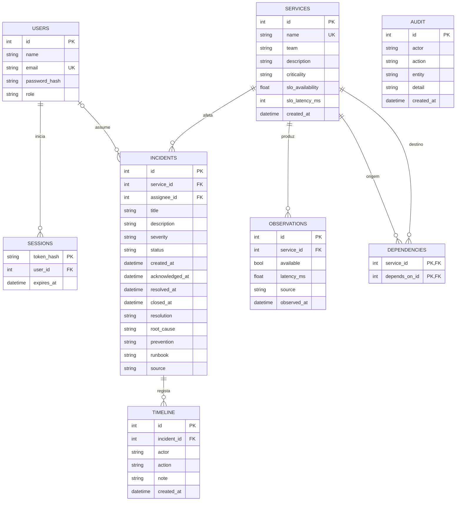

> Este documento descreve uma etapa anterior do protótipo. Para o estado atual da versão 0.3, consultar [o ciclo real e a arquitetura de integração](ciclo-real.md).

# Arquitetura da versão 0.1

## Decisões

O servidor usa Python e FastAPI para expor uma API validada e permitir acrescentar recuperação semântica na mesma linguagem. SQLite reduz a configuração inicial e mantém os dados locais. A interface usa HTML, CSS e JavaScript sem framework nem build, servidos pela mesma aplicação e origem. Esta escolha mantém o primeiro percurso fácil de executar e permite uma evolução futura do frontend sem alterar os contratos da API.

O browser comunica com a API por JSON. O cookie de sessão é enviado apenas à mesma origem; o token não fica em localStorage. Os dados de incidentes, observações e auditoria são persistentes. As datas são guardadas em UTC e apresentadas pelo browser no fuso horário local.

O simulador escreve observações marcadas como `demo`. Não executa chamadas a servidores reais nem tenta inferir saúde a partir dos nomes dos serviços. Nenhuma sugestão executa comandos. O TF-IDF é uma implementação de referência em Python, para permitir estudar e avaliar a recuperação antes de acrescentar dependências de modelos.

## Componentes do código

- `app/main.py`: criação da aplicação, autenticação, dependências de autorização e rotas.
- `app/db.py`: esquema SQL, transações e funções de registo de eventos.
- `app/models.py`: contratos de entrada, limites e validação.
- `app/security.py`: hashing de palavras-passe e tokens.
- `app/seed.py`: criação única de contas, serviços e incidentes sintéticos.
- `app/search.py`: normalização, TF-IDF, cosseno e ordenação dos resultados.
- `web/app.js`: navegação, formulários e comunicação com a API.
- `web/style.css`: interface adaptável, estados e foco de teclado.

## Modelo de dados

Auditoria e timeline guardam o nome do ator como texto de registo. As equipas são também texto nesta versão; entidades normalizadas de equipas, SLIs/SLOs e regras de alertas serão necessárias na fase seguinte. O runbook e o post-mortem pertencem ao incidente nesta versão, sem catálogo independente.

## Regras de negócio

O fluxo é `open → acknowledged → investigating → resolved → closed`. Não são permitidos saltos. O reconhecimento exige responsável com perfil de operação ou administração. A resolução exige uma descrição com pelo menos dez caracteres. O fecho exige causa raiz e prevenção, cada uma com pelo menos dez caracteres; o runbook é opcional.

A recuperação de um serviço não fecha um incidente automaticamente. Alertas repetidos do simulador são agrupados por serviço, e as criações concorrentes são protegidas por transação e índice único parcial. A linha temporal regista os alertas repetidos. Não existe ainda uma máquina de estados separada para alertas, nem aumento automático de prioridade se o tipo de falha de um incidente ativo mudar.

MTTA e MTTR usam o instante de criação do incidente como referência nesta versão. A integração futura terá de distinguir o início da falha, a deteção e a criação do incidente.

## Pesquisa

O corpus inclui apenas incidentes resolvidos ou fechados, usando título, descrição, resolução e causa raiz. O texto é normalizado para minúsculas, sem acentos, tokenizado e filtrado por uma lista pequena de palavras frequentes. Calcula-se TF logarítmico e IDF suavizado; normalizam-se vetores e calcula-se o cosseno. A consulta usa o vocabulário do corpus. Resultados com similaridade zero são omitidos.

O valor entre zero e um é uma similaridade textual. Não representa confiança estatística, probabilidade de diagnóstico ou qualidade da solução. O ranking ainda não considera permissões por equipa ou contexto temporal.

## Limites de operação

Esta versão suporta uma instância local. SQLite usa foreign keys, WAL e transações; não há sistema de migrações nem workers distribuídos. O rate limit de login é persistido em SQLite, com limites por conta e IP que não são apagados por um login válido noutra conta. O trilho de auditoria não é inviolável contra quem tenha acesso direto à base de dados. Não existe recuperação de palavra-passe, gestão de utilizadores ou MFA. A base deve ficar local e o serviço associado a loopback.

A revisão de 24/10/2026 acrescentou uma allowlist de Host, rejeição de bases demo em modo sem demo, limite de corpo antes da interpretação JSON e um perfil de produção que recusa demonstração e HTTP e força cookies Secure. Esse perfil não configura TLS ou um reverse proxy nem demonstra segurança de um deployment real.

O Dockerfile usa um utilizador sem privilégios e o Compose publica a porta apenas em loopback. Esses ficheiros ainda precisam de validação com Docker disponível. Não foi criado um deploy externo nem um repositório remoto.

## Referências técnicas

- [FastAPI — ciclo de vida da aplicação](https://fastapi.tiangolo.com/advanced/events/)
- [Prometheus — configuração de recolha, para a fase seguinte](https://prometheus.io/docs/prometheus/latest/configuration/configuration/)
