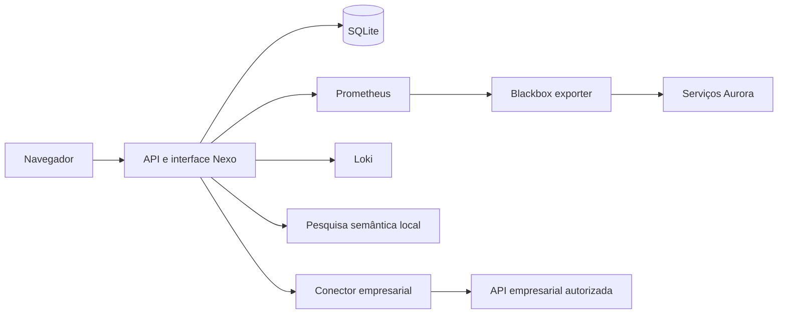

# Arquitetura

## Componentes

O Nexo serve a interface e a API na mesma origem. FastAPI valida entradas, sessões
e permissões; SQLite mantém os dados com WAL e transações explícitas. O frontend
usa HTML, CSS e JavaScript sem framework nem compilação.

Na stack de laboratório, Prometheus e o blackbox exporter recolhem sondagens HTTP,
Loki permite consultar logs e um serviço semântico local calcula embeddings. A
Aurora disponibiliza serviços fictícios instrumentados para ensaiar falhas. A
integração empresarial usa um contrato de API validado por um conector, separado
do transporte e das credenciais.

## Código

- `app/main.py`: composição, middleware, sessões e rotas ainda não extraídas.
- `app/db.py`: esquema, migrações, transações e cronologia/auditoria.
- `app/models.py` e modelos dos módulos: contratos e limites de entrada.
- `app/security.py` e `app/accounts.py`: palavras-passe, sessões e contas.
- `app/alerts.py`, `app/monitoring.py`, `app/telemetry.py`, `app/slo.py`: observações e regras.
- `app/enterprise.py`, `app/connectors/`, `app/enterprise_monitoring.py`: integração e recolha empresarial.
- `app/incident_*.py` e `app/follow_ups.py`: consulta, conhecimento aplicado, impacto, concorrência e prevenção.
- `app/dossier.py` e `app/printable_dossier.py`: fotografia consistente e exportações.
- `app/recovery.py`, `app/portable.py` e módulos de manutenção: recuperação verificada.
- `web/`: navegação, formulários e apresentação.

## Persistência

Utilizadores iniciam sessões e podem assumir incidentes. Serviços têm dependências,
observações, objetivos e regras. Incidentes preservam datas, post-mortem, cronologia,
evidências e contexto da deteção. Auditoria regista as operações relevantes.

As ações de prevenção e o conhecimento aplicado são eventos estruturados da
cronologia. O estado das ações é reconstruído desses eventos. As decisões não
reescrevem eventos anteriores; a resolução e o fecho do incidente permanecem
separados do acompanhamento posterior.

A atribuição e as transições usam uma revisão do incidente, verificada dentro de
uma transação de escrita. O portal envia a revisão apresentada ao operador;
clientes antigos que omitam a revisão mantêm o comportamento anterior.

## Instalação e fronteiras

A sessão usa um cookie HttpOnly e SameSite Strict; apenas o hash do token fica na
base de dados. A API aplica permissões e valida origem dos pedidos de escrita.
Credenciais de integração ficam no servidor. Sugestões de conhecimento não executam
comandos ou correções. Datas persistidas usam UTC.

O laboratório e cada instalação de referência têm dados e configuração próprios.
A separação é feita por instalação. Dentro da mesma instalação, os três perfis
consultam os mesmos incidentes; não existe isolamento por equipa.

A pré-produção usa um proxy HTTPS e uma API empresarial TLS privada. A confiança da
CA é configurada no cliente do ensaio, sem desativar validação de certificados.
Os procedimentos e limites estão nos guias de [pré-produção](preproducao-https.md),
[integração HTTPS](api-empresarial-https.md) e [recuperação](copias-restauro.md).
